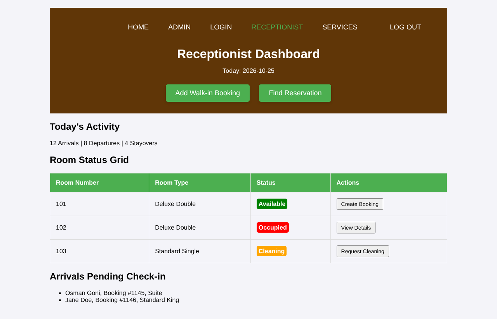
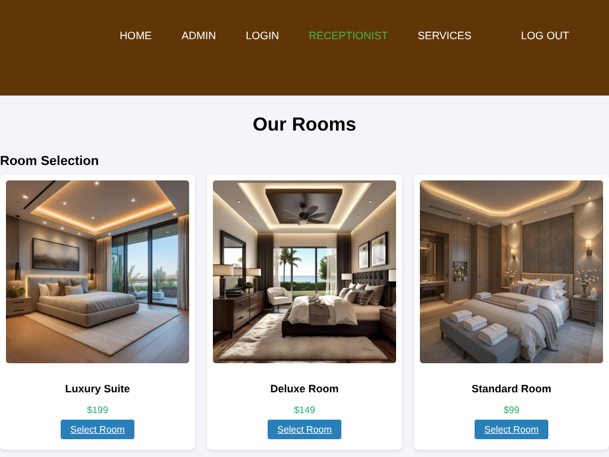
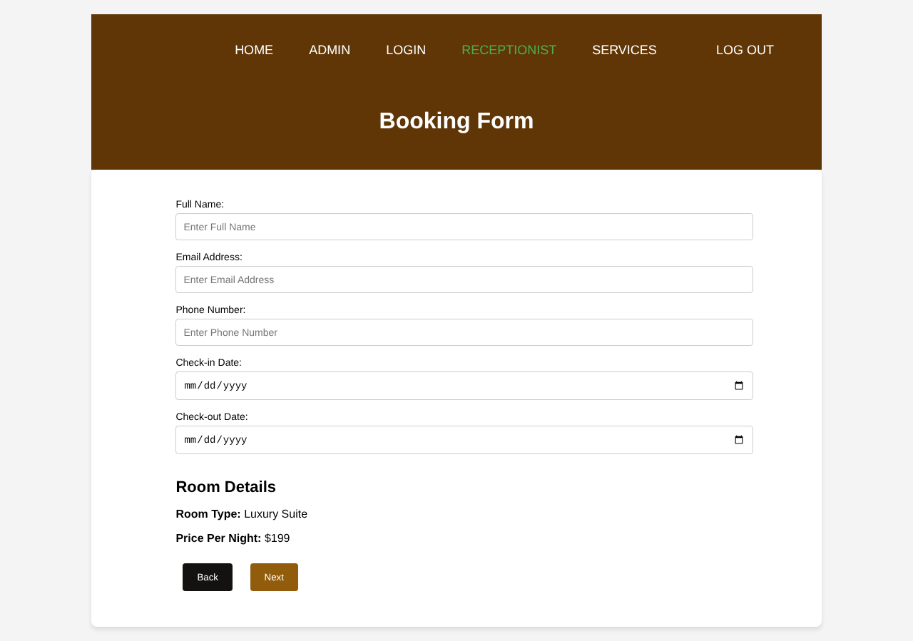

# Hotel Reservation System

A web app for hotel front-desk staff. A receptionist logs in, sees the day at a glance, picks a room for a guest who walks in, and fills in the booking form. It is built with plain PHP, HTML and CSS.

This is a work in progress. The screens below all run, but saving bookings and real login are not built yet. The "Not finished yet" section lists exactly what is missing.

## Screenshots

Receptionist dashboard:



Choosing a room for a walk-in guest:



Booking form, filled with the room the receptionist picked:



## What it does right now

- Login page. The receptionist enters an email and password and lands on the dashboard.
- Dashboard. Shows today's date, a summary of arrivals and departures, a room status table (available, occupied, needs cleaning) and the guests waiting to check in. It also has two buttons: Add Walk-in Booking and Find Reservation.
- Room selection. Nine room types, from the Standard Room at $99 to the Penthouse at $399. Each card has a photo, a name, a price per night and a Select Room button.
- Booking form. Takes the guest's full name, email, phone number, check-in date and check-out date. The room name and price from the previous page are shown on the form, and the form will not submit until every field is filled in.

The room and price travel from the room page to the booking form in the URL (`addbooking.php?room=Luxury%20Suite&price=199`). The page checks that the price is a number and escapes the room name before showing it.

## Pages

| File | What it is |
| --- | --- |
| `php/loginreceptionist.php` | Login screen |
| `php/receptionist.php` | Receptionist dashboard |
| `php/rooms.php` | Room selection |
| `php/addbooking.php` | Walk-in booking form |

Each page has its own stylesheet in `css/` with a matching name. `css/bookingdetails.css` and `css/findreservation.css` are for two pages that are still to come.

## Built with

- PHP (tested on 8.3)
- HTML and CSS
- No database and no JavaScript libraries yet

## Run it on your computer

The pages link to each other with paths that start with `/Summer-wbt-2025/Hotel_Reservation_System/`, so the project folder has to sit at exactly that place under your web server's root, and the folder must be named `Hotel_Reservation_System`.

With XAMPP:

1. Create the folder `C:\xampp\htdocs\Summer-wbt-2025`.
2. Download or clone the project into it, and make sure the project folder is named `Hotel_Reservation_System`. If you clone, use:

   ```bash
   cd C:\xampp\htdocs\Summer-wbt-2025
   git clone https://github.com/ReduoneAhmed/Hotel-Reservation-system.git Hotel_Reservation_System
   ```

3. Start Apache from the XAMPP control panel.
4. Open this address in your browser:

   ```
   http://localhost/Summer-wbt-2025/Hotel_Reservation_System/php/loginreceptionist.php
   ```

Without XAMPP, you can use PHP's built-in server. Go to the folder that contains `Summer-wbt-2025` and run:

```bash
php -S localhost:8000
```

Then open `http://localhost:8000/Summer-wbt-2025/Hotel_Reservation_System/php/loginreceptionist.php`.

On the login page, type any email and any password. The login does not check them yet.

## Project structure

```
Hotel_Reservation_System/
├── css/
│   ├── addbooking.css
│   ├── bookingdetails.css
│   ├── findreservation.css
│   ├── loginreceptionist.css
│   ├── receptionist.css
│   └── rooms.css
├── images/
│   ├── bg-1.jpg
│   ├── bg-2.png
│   ├── room1.jpg
│   ├── room2.jpg
│   └── room3.jpg
├── php/
│   ├── addbooking.php
│   ├── loginreceptionist.php
│   ├── receptionist.php
│   └── rooms.php
└── screenshots/
```

## Not finished yet

- Login accepts any email and password. There is no user table and no session check.
- The dashboard numbers, room table and arrival list are sample data written into the page.
- Bookings are not saved. The Next button on the booking form posts to `php/bookingdetails.php`, which has not been added.
- Find Reservation points to `php/reservation_view.php`, which has not been added.
- The menu links Home, Admin and Services point to `index.php`, `admin.php` and `services.php`, which have not been added.
- The Create Booking button in the dashboard's room table points to `html/rooms.html`, which does not exist. Add Walk-in Booking at the top of the dashboard works.
- Four room photos are missing (`room4.jpeg`, `room6.jpeg`, `room7.jpeg`, `room9.jpeg`), so five of the nine room cards show a broken image. The login page also expects a background called `lobby.jpeg`.

## Author

Md. Reduone Ahmed, [github.com/ReduoneAhmed](https://github.com/ReduoneAhmed)
